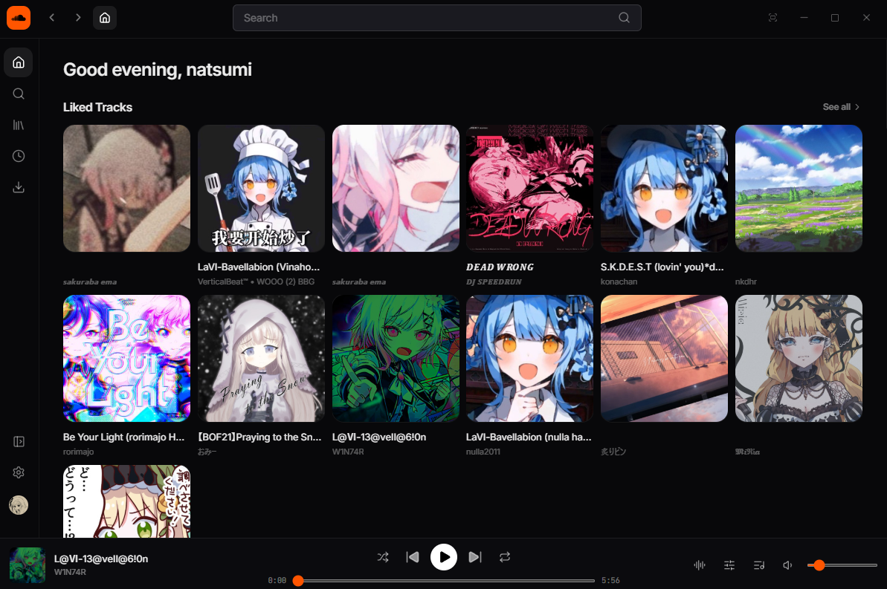
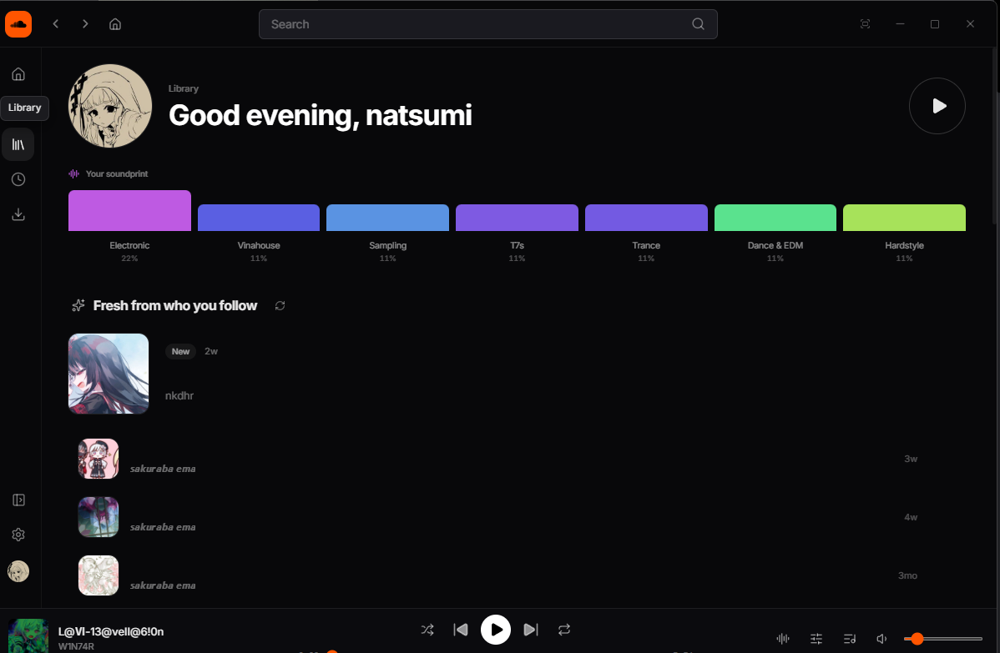
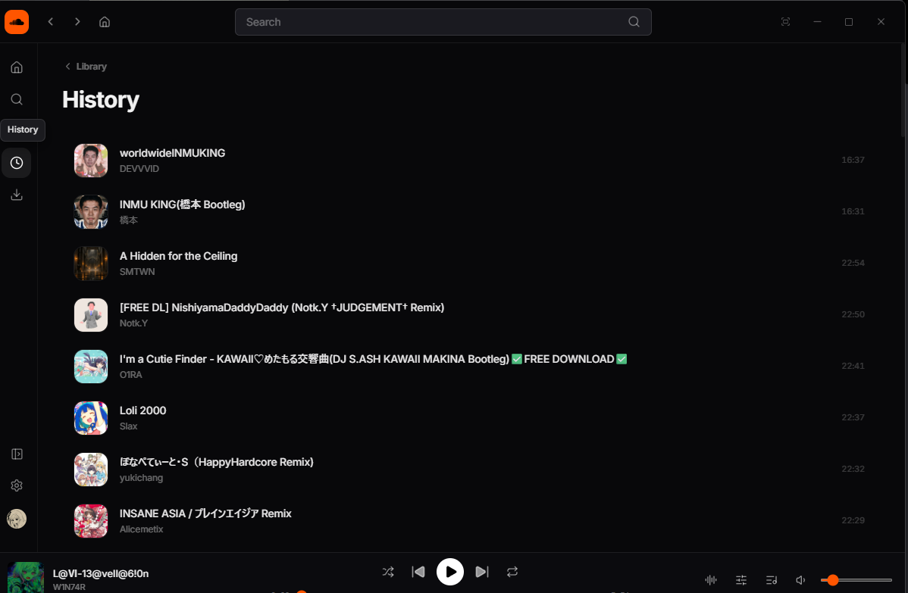

<p align="center">
<a href="https://github.com/Jomvet-lovers/soundcloud-desktop/releases/latest">

</a>
</p>
<h1 align="center">SoundCloud Desktop</h1>

<p align="center">
<a href="README.md">English</a> | <a href="README.ja.md">日本語</a>
</p>

<p align="center">
<a href="https://github.com/Jomvet-lovers/soundcloud-desktop/releases/latest">

</a>
<a href="https://github.com/Jomvet-lovers/soundcloud-desktop/releases">

</a>
</p>

> [!WARNING]
> **個人利用を目的とした非公式クライアントです。自己責任でご使用ください。**
> 登録・許可された SoundCloud API クライアントではなく、Web プレイヤーと
> 同じ方法で SoundCloud と通信します。本クライアントの使用によって生じた
> 問題について、作者および貢献者は一切の責任を負いません。

> 本リポジトリは [SoundCloud-Desktop](https://github.com/zxcloli666/SoundCloud-Desktop)
> （作者 [@zxcloli666](https://github.com/zxcloli666)、MIT ライセンス）を
> ベースにした独立した改造版です。

## このビルドについて

これは **direct モード** ビルド（SCD-Direct）です。上流プロジェクトの
ベンダーバックエンド（`api.scnative.space`）を使わず、SoundCloud 本体と
直接通信します。

- **読み取り** は Web プレイヤーが使う公開 `api-v2` エンドポイントを利用します。
- **書き込み**（いいね / フォロー / コメント / プレイリスト / 公開範囲 /
  再生履歴）は、アプリ内の隠し `soundcloud.com` ページ経由で行われ、
  実際のアカウントに反映されます。
- **サインイン** はアプリ内ウィンドウで行います。セッションはローカルに
  保存され、SoundCloud 以外のサーバーには送信されません。

第三者のサービスへの登録も、プロキシもリレーも不要です。

## スクリーンショット

スクリーンショットは以前のビルドのものです（現在のレイアウトは簡素化されています）。







## 機能

### 再生

- ストリーミング再生、キュー、シャッフル、リピート
- シーク（波形、スライダー、コメントのタイムスタンプ、A-B リピート）
- 再生速度とピッチの調整
- プリセット付き 10 バンドイコライザー（プリセットを選ぶと EQ がオンになります）
- 音量のノーマライズ
- 再生バーと設定の両方から出力デバイスを選択。システム既定に追従するか、
  特定のデバイスを固定できます（再起動後も保持）
- メディアキー、トレイ操作、Discord Rich Presence

### ライブラリと発見

- いいねしたトラック、プレイリスト、フォロー一覧、フォローフィード
- 再生履歴: 履歴タブ用のローカルログに加え、Web プレイヤーと同じ方法で
  再生を SoundCloud に報告する（15 秒後）ため、soundcloud.com 側の履歴にも残ります
- トラック / ユーザー / プレイリスト / アルバムの検索、タグページ
- 波形・コメント（閲覧と投稿）・関連トラックを備えたトラックページ
- プレイリスト編集: 作成、曲の追加・削除、ドラッグで並べ替え、削除、
  サイドバーへのピン留め
- アーティストページ、アルバムページ

### 同期

- いいね / フォロー / コメント / プレイリストの変更 / 公開範囲は
  **SoundCloud を先に**更新し、SoundCloud が受け付けたときだけローカルに反映します
- SoundCloud が拒否した場合（ボット判定など）や到達できない場合は、
  ローカルには何も適用せず、理由を UI に表示します（起きていない変更を見せません）
- いいねのキャッシュはアカウント単位なので、アカウントを切り替えても混ざりません

### オフラインとダウンロード

- いいねしたトラックをまとめて、または 1 曲ずつキャッシュして
  ネットワークなしで再生
- キャッシュ容量の上限を設定可能（既定 1 GB、設定 > ストレージ）
- M4A (AAC) / MP3 (320 kbps) / FLAC / WAV で書き出し

### アップロード

- 音声ファイルをアートワーク、タイトル、アーティスト、ジャンル、タグ、
  公開範囲と一緒にアップロード

### カスタマイズ

- テーマとアクセントカラーのプリセット
- オーディオ、ストレージ、起動、Discord の設定
- タッチ端末向けのオンスクリーンキーボード（任意）

## サインイン

ログイン画面の **Sign in with SoundCloud** を押すと、アプリ内ウィンドウで
soundcloud.com が開きます。そこでサインインするとセッションが自動的に取得され、
アプリのデータディレクトリに保存されます。

セッションが送信されるのは SoundCloud に対してのみです。

## 保存場所

- **Windows**
  - セッションと設定: `%APPDATA%\fun.natsumi.scd.direct`
  - キャッシュとログ: `%LOCALAPPDATA%\fun.natsumi.scd.direct`
- **Linux**
  - セッションと設定: `~/.local/share/fun.natsumi.scd.direct`
  - キャッシュとログ: `~/.cache/fun.natsumi.scd.direct`

これらのディレクトリを削除するとサインアウトされ、オフラインキャッシュも消えます。

## ビルド

Windows に必要なもの: Rust（MSVC ツールチェーン）、Visual Studio Build Tools、
CMake、NASM、LLVM (libclang)、Node.js 20+（Vite 8 は 20.19 以上が必要）。

```sh
cd desktop
corepack pnpm install
corepack pnpm tauri dev                     # 開発（Vite HMR）
corepack pnpm tauri build --bundles nsis    # リリース + NSIS インストーラー
```

Linux では先に WebKitGTK のビルド依存関係
（`libwebkit2gtk-4.1-dev`、`libappindicator3-dev`、`librsvg2-dev`、`patchelf`、
`libasound2-dev`）を入れてから `corepack pnpm tauri build` を実行します。

チェック（`desktop/` で実行）:

```sh
npx tsc --noEmit
npx biome check src
cd src-tauri && cargo check && cargo test --lib
```

## 制限事項

- 非公式・個人利用向けです。SoundCloud は予告なく API を変更することがあります。
- 書き込みは SoundCloud 側で拒否されることがあります（ボット判定、非公開・
  削除済みのコンテンツなど）。その場合アプリはエラーを表示し、何も変更しません。
- UI は英語のみです。
- 主な対象は Windows です。Linux ビルドは CI で生成しており、動作確認は軽めです。

## クレジット / ライセンス

[zxcloli666/SoundCloud-Desktop](https://github.com/zxcloli666/SoundCloud-Desktop) を
ベースにしています。MIT ライセンス（[LICENSE](LICENSE) を参照）。
